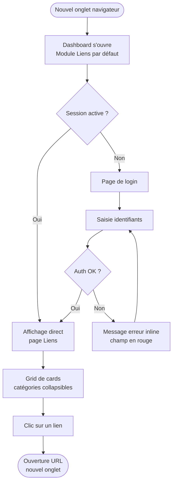
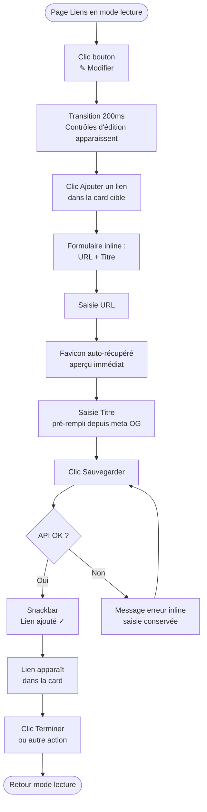
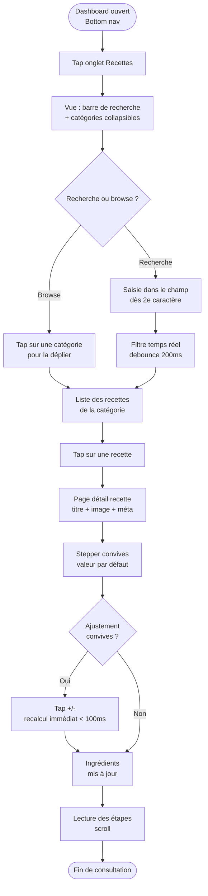
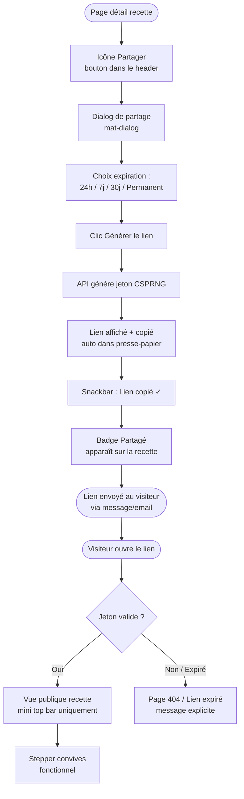
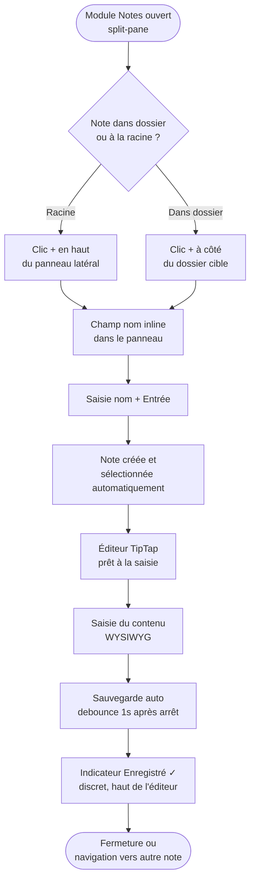

# UX Design Specification Dashboard

**Author:** Manu
**Date:** 2026-04-21

---

<!-- UX design content will be appended sequentially through collaborative workflow steps -->

## Executive Summary

### Project Vision

Dashboard est une application web personnelle auto-hébergée qui centralise trois usages quotidiens — Liens, Recettes, Notes — sous une interface unique et cohérente. Déployable via un seul `docker-compose up`, elle garantit la souveraineté des données sans dépendance à un service cloud tiers.

### Target Users

**Manu (admin, utilisateur principal)**
Développeur expérimenté, auto-hébergeur. Utilise Dashboard sur desktop comme page d'accueil quotidienne du navigateur et sur mobile pour consulter ses recettes en cuisine ou partager un contenu rapidement.

**Famille et amis proches (utilisateurs secondaires, < 10 personnes)**
Profils non techniques. Reçoivent des liens de partage (recette, note) et consultent le contenu sans créer de compte. Parcours limité à la consultation.

### Key Design Challenges

- **Dualité lecture / édition** : Manu doit pouvoir basculer en mode édition rapidement depuis son usage quotidien, sans que les contrôles d'édition polluent l'expérience de lecture.
- **Responsive multi-modules** : trois modules aux layouts radicalement différents (grid de liens, split-pane notes, liste recettes) doivent offrir une expérience mobile cohérente et fluide.
- **Isolation des vues publiques** : les visiteurs sans compte doivent voir uniquement le contenu partagé, sans accéder ni découvrir le reste de l'application.

### Design Opportunities

- Un mode lecture sans aucun bruit visuel encourage l'adoption quotidienne comme page d'accueil (critère de succès principal).
- Une cohérence visuelle forte entre les trois modules renforce la perception d'un outil unifié plutôt qu'une collection d'apps distinctes.

## Core User Experience

### Defining Experience

L'interaction de référence est la consultation quotidienne des liens : ouvrir un nouvel onglet et trouver instantanément la ressource voulue. Tout le design part de cette action — rapide, sans friction, sans bruit visuel.

### Platform Strategy

- **Web responsive** : deux breakpoints principaux (desktop / mobile)
- **Desktop-first** pour le module Liens (page d'accueil navigateur)
- **Mobile-first** pour Recettes et Notes (consultation en situation)
- **PWA basique** (app shell mis en cache) pour les modules mobiles
- Aucune capacité native requise en V1 ; pas d'offline data

### Effortless Interactions

- **Liens en mode lecture** : page propre, zéro contrôle d'édition visible — l'interface s'efface derrière le contenu
- **Recherche recettes** : filtrage en temps réel dès la saisie, pas de bouton "Rechercher"
- **Stepper convives** : recalcul des quantités immédiat, sans validation
- **Navigation inter-modules** : toujours visible et accessible en un clic (top bar desktop, bottom nav mobile)
- **Partage public** : le visiteur voit directement le contenu, aucune inscription ni interstitiel

### Critical Success Moments

1. Dashboard remplace la page d'accueil du navigateur → adoption quotidienne
2. Un visiteur ouvre un lien partagé et accède à la recette sans friction
3. Manu ajoute un lien en mode édition en moins de 30 secondes
4. Sur mobile, trouver et consulter une recette depuis la cuisine en < 3 taps

### Experience Principles

1. **Lecture d'abord** : l'interface de consultation est toujours propre et sans bruit ; les contrôles d'édition ne s'affichent que sur demande explicite
2. **Temps réel, pas de rechargements** : filtres, stepper, ajout dynamique d'ingrédients/étapes — tout se passe dans la page
3. **Cohérence cross-module** : mêmes patterns visuels (cards, collapsibles, navigation) d'un module à l'autre pour réduire la charge cognitive
4. **Public sans friction** : les vues partagées n'exposent aucun élément de navigation privée et sont accessibles sans compte

## Desired Emotional Response

### Primary Emotional Goals

Dashboard est un outil personnel à usage quotidien. L'objectif émotionnel principal n'est pas l'excitation ou la surprise, mais **le calme et le contrôle** : l'utilisateur sait que tout ce dont il a besoin est là, bien rangé, accessible sans friction.

Émotions cibles par rôle :
- **Manu (usage quotidien)** : calme, efficacité, sentiment de maîtrise
- **Visiteur partagé** : confiance immédiate, absence de barrières

### Emotional Journey Mapping

| Moment | Émotion visée |
|--------|---------------|
| Ouverture d'un nouvel onglet → module Liens | Calme, repère familier |
| Clic sur un lien | Fluidité, rien ne ralentit |
| Activation du mode édition | Contrôle, maîtrise de l'espace |
| Ajout d'un lien / recette / note | Satisfaction discrète — "c'est rangé" |
| Consultation d'une recette partagée (visiteur) | Confiance, accès immédiat |
| Erreur de formulaire | Réassurance — saisie préservée, message clair |
| Retour après quelques jours | Familiarité, continuité |

### Micro-Emotions

- **Confiance > Scepticisme** : interface stable, cohérente, sans surprises
- **Calme > Anxiété** : mode lecture sans bruit visuel, contrôles d'édition cachés par défaut
- **Accomplissement > Frustration** : actions courtes (< 30 s pour ajouter un lien), feedback immédiat
- **Appartenance > Isolation** : le visiteur se sent bienvenu (vue publique soignée), pas confronté à un mur de login

### Design Implications

- **Calme** → palette neutre, espacement généreux, mode lecture sans boutons d'édition visibles
- **Contrôle** → mode édition activé explicitement, jamais imposé ; drag & drop pour réorganiser
- **Confiance (visiteur)** → vue publique avec mini top bar identifiable (contexte "Dashboard") mais sans navigation vers l'intérieur
- **Réassurance** → validation inline des formulaires, pas de perte de données sur erreur, messages d'erreur explicites

### Emotional Design Principles

1. **Discrétion par défaut** : l'interface s'efface ; les outils d'édition n'apparaissent que quand l'utilisateur les demande
2. **Feedback immédiat** : toute action (stepper, recherche, ajout d'item) produit une réponse visuelle instantanée — pas de doute sur ce qui s'est passé
3. **Cohérence rassurante** : les mêmes patterns visuels d'un module à l'autre réduisent la charge cognitive et créent un sentiment de familiarité
4. **Zéro barrière pour le visiteur** : un lien partagé s'ouvre directement sur le contenu — la confiance du visiteur se gagne dès les premières secondes

## UX Pattern Analysis & Inspiration

### Inspiring Products Analysis

**Dashy / Homepage** (inspiration module Liens)
- Résout la fragmentation des favoris avec une vue en grid de cards par catégorie
- Navigation : aucune — la page *est* la navigation
- Pattern retenu : grid responsive de cards collapsibles, favicon + titre = affordance suffisante

**Mealie** (inspiration module Recettes)
- Catégorisation + recherche sur une seule page = pas de sous-pages par catégorie
- Stepper convives avec recalcul automatique des quantités : interaction signature
- Pattern retenu : vue unique recherche + catégories, stepper comme composant central de la page détail

**OneNote** (inspiration module Notes)
- Structure à deux niveaux (dossier / sous-dossier / note) = hiérarchie suffisante sans profondeur excessive
- Split-pane (arborescence gauche + éditeur droite) = navigation et édition simultanées
- Pattern retenu : panneau latéral + zone éditeur, ajout inline sans changer de page

**Notion / TipTap** (inspiration éditeur de notes)
- WYSIWYG riche mais léger via ProseMirror
- Toolbar contextuelle (apparaît sur sélection) plutôt que toolbar fixe
- Pattern retenu : TipTap avec toolbar persistante pour les notes (usage desktop + mobile), markdown léger pour les étapes de recettes (texte court)

### Transferable UX Patterns

**Navigation**
- *Top bar avec onglets* (Linear, Notion) → top bar Desktop Dashboard : stable, toujours visible, 3 items max
- *Bottom nav bar* (apps mobiles Android/iOS Material) → mobile Dashboard : thumb-friendly, labels courts

**Interaction**
- *Mode lecture / mode édition toggle* (Notion pages, Google Docs) → module Liens : propre en lecture, outillé en édition
- *Filtrage temps réel sans bouton submit* (Spotlight, Linear search) → recherche recettes
- *Ajout d'items inline* (Todoist, Linear) → ajout d'ingrédients/étapes dans le formulaire recette

**Visuel**
- *Cards collapsibles avec header cliquable* (GitHub Accordion, Notion toggles) → catégories Liens et Recettes
- *Split-pane resizable* (VS Code, OneNote Web) → module Notes desktop

### Anti-Patterns to Avoid

- **Hamburger menu pour 3 sections** : sur-engineering, crée une friction inutile sur mobile (confirmé : bottom nav choisie à la place)
- **Pages admin séparées pour l'édition** : détour cognitif cassant le contexte (confirmé : mode édition inline pour les Liens)
- **Interstitiel de login sur les vues publiques** : bloque le visiteur avant qu'il voie le contenu (confirmé : vues publiques accessibles directement)
- **Colonnes fixes paramétrables par l'utilisateur** : sur-engineering pour V1, le CSS responsive suffit
- **WYSIWYG complet pour les étapes de recettes** : texte court ne justifie pas la complexité ; markdown léger suffisant (TipTap réservé aux Notes)

### Design Inspiration Strategy

**À adopter tel quel**
- Split-pane OneNote pour le module Notes (sidebar + éditeur)
- Bottom nav Material pour mobile (3 items, icônes + labels)
- Filtrage temps réel pour la recherche recettes

**À adapter**
- Grid Dashy → grid responsive CSS uniquement (pas de paramètre colonnes utilisateur)
- Stepper Mealie → intégré dans la page détail avec recalcul immédiat des quantités
- Toolbar TipTap → toolbar persistante (pas contextuelle) pour faciliter l'usage mobile

**À éviter**
- Toute navigation secondaire sur les vues publiques
- Double navigation (top bar + sidebar) sur desktop pour les modules Liens et Recettes
- Modales pour la création de contenu (préférer pages dédiées ou inline)

## Design System Foundation

### Design System Choice

**Angular Material** — bibliothèque de composants officielle Angular, basée sur Material Design 3.

### Rationale for Selection

- **Cohérence native** : Angular Material est conçu pour Angular ; pas de wrapper tiers, pas d'incompatibilité de cycle de détection
- **Vitesse de développement** : composants accessibles, themeable et documentés out-of-the-box ; pas de roue à réinventer pour les patterns courants
- **Profil projet** : outil personnel auto-hébergé → la rapidité d'implémentation prime sur l'unicité visuelle
- **Couverture fonctionnelle** : tous les composants V1 ont un équivalent direct dans Angular Material (toolbar, tabs, bottom nav, cards, expansion panels, form fields, stepper, dialog, snackbar)
- **Thématisation** : le système de thèmes Material (design tokens CSS) supporte nativement les thèmes clair/sombre avec un simple toggle

### Implementation Approach

Installation : `ng add @angular/material`

Composants Angular Material utilisés par module :

| Composant | Usage |
|-----------|-------|
| `mat-toolbar` | Top bar globale |
| `mat-tab-nav-bar` | Onglets de navigation desktop |
| `mat-bottom-nav` / `mat-bottom-sheet` | Navigation mobile |
| `mat-card` | Cards de catégories (Liens, Recettes) |
| `mat-expansion-panel` | Catégories collapsibles |
| `mat-form-field` + `mat-input` | Formulaires (login, recettes, notes) |
| `mat-icon-button` | Toggle thème, boutons d'action inline |
| `mat-menu` | Menu utilisateur (déconnexion) |
| `mat-snack-bar` | Notifications de feedback (sauvegarde, erreur) |
| `mat-dialog` | Confirmations de suppression |
| `mat-chip` | Tags / catégories dans les formulaires |

### Customization Strategy

- **Thème clair/sombre** : deux palettes Material définies dans `styles.scss`, switchées via une classe CSS sur `<body>` (`.dark-theme`), persistées en `localStorage`
- **Design tokens** : couleurs primaire, secondaire et d'accentuation définies comme tokens CSS custom pour permettre l'évolution vers des thèmes supplémentaires en V2
- **Typography** : police système par défaut (performance, pas de dépendance externe) — Material typography scale appliquée
- **Composants custom** : uniquement pour les besoins non couverts par Material (éditeur TipTap, stepper convives, drag & drop listes)

## Design Direction Decision

### Design Directions Explored

6 directions visuelles explorées appliquant la palette Option A (Noir & Braise) sur le module Liens :

| # | Nom | Caractéristique |
|---|-----|----------------|
| 01 | Minimaliste Plat | Zéro ombre, séparateurs fins |
| 02 | Accent Bordure | Bordure gauche rouge, style dev-tool |
| 03 | Cards Élevées | Ombres prononcées, badge compteur rouge |
| 04 | Compact Dense | Grille 3 colonnes, densité maximale |
| 05 | Headers Dégradés | En-tête de card avec dégradé rouge |
| 06 | Glassmorphism | Surfaces semi-transparentes (sombre uniquement) |

### Chosen Direction

**Direction 03 — Cards Élevées** avec ajustement de la top bar thème clair.

Combinaison retenue :
- **Structure et corps** : Direction 03 — cards avec ombres prononcées, espacement généreux, badge compteur de liens par catégorie (rouge sur fond rouge/10%)
- **Top bar thème clair** : fond `#FFFFFF` + ombre légère `box-shadow: 0 2px 8px rgba(0,0,0,0.1)` + app name `#B71C1C` — Direction 03 pure, sans ajustement
- **Top bar thème sombre** : fond `#141414` + app name `#EF4444`, inchangée

### Design Rationale

- **Cards Élevées** : l'espacement et les ombres créent une hiérarchie visuelle claire sans avoir recours à la couleur — les cards "flottent" au-dessus du fond, ce qui est lisible dans les deux thèmes
- **Top bar blanche thème clair** : fond blanc avec ombre légère — cohérent avec l'élévation des cards, l'identité rouge est portée par l'app name `#B71C1C` et l'onglet actif, sans charger la top bar elle-même
- **Badge compteur** : information utile (combien de liens dans cette catégorie) sans ajouter de UI — s'intègre dans le header de card sans encombrer

### Implementation Approach

**Cards (`mat-card`)** :
```scss
mat-card {
  box-shadow: 0 4px 16px rgba(0,0,0,0.12), 0 1px 4px rgba(0,0,0,0.08);
  border-radius: 10px;
}
.dark-theme mat-card {
  box-shadow: 0 6px 20px rgba(0,0,0,0.6), 0 2px 6px rgba(239,68,68,0.06);
}
```

**Badge compteur** :
```html
<mat-chip disableRipple>{{ category.links.length }}</mat-chip>
```
Stylé avec `background: rgba(primary, 0.1)` et `color: primary`.

**Top bar** :
```scss
// light theme
mat-toolbar { background: #FFFFFF; box-shadow: 0 2px 8px rgba(0,0,0,0.1); }
.app-name { color: #B71C1C; }
// dark theme
mat-toolbar { background: #141414; }
.app-name { color: #EF4444; }
```

## Visual Design Foundation

### Color System

**Palette choisie : "Braise Profonde"** *(remplace "Noir & Braise" — Sprint Change Proposal 2026-05-20)*

| Token | Thème sombre | Thème clair |
|-------|-------------|-------------|
| `--color-background` | `#0A0A0A` | `#F5F5F5` |
| `--color-surface` | `#1C1C1C` | `#FFFFFF` |
| `--color-primary` | `#EF4444` (rouge pur) | `#B71C1C` (Red-900) |
| `--color-primary-light` | `#F87171` (survols/focus) | `#D32F2F` |
| `--color-on-primary` | `#FFFFFF` | `#FFFFFF` |
| `--color-text-primary` | `#FFFFFF` | `#212121` |
| `--color-text-secondary` | `#9E9E9E` | `#757575` |
| `--color-divider` | `#2A2A2A` | `#E0E0E0` |
| `--color-error` | `#FF6B6B` | `#C62828` |
| `--color-warning` | `#FFB74D` (Orange-300) | `#F57C00` (Orange-700) |
| `--color-on-warning` | `#1C1C1C` | `#FFFFFF` |
| `--color-success` | `#66BB6A` (Green-400) | `#2E7D32` (Green-800) |
| `--color-on-success` | `#1C1C1C` | `#FFFFFF` |

**Overrides AM3 (cause racine des fonds rosés en thème clair) :**

| Token AM3 | Thème sombre | Thème clair |
|-----------|-------------|-------------|
| `--mat-sys-primary` | `#EF4444` | `#B71C1C` |
| `--mat-sys-primary-container` | `#7F1D1D` | `#FECACA` |
| `--mat-sys-on-primary-container` | `#FECACA` | `#7F1D1D` |
| `--mat-sys-surface-container` | `#222222` | `#FFFFFF` ← cards blanches |
| `--mat-sys-surface-container-low` | `#1C1C1C` | `#FAFAFA` |
| `--mat-sys-surface-container-high` | `#2A2A2A` | `#F0F0F0` |
| `--mat-sys-surface-container-highest` | `#333333` | `#E8E8E8` |

**Rationale :**
- `#EF4444` (rouge pur, Tailwind red-500) sur fond sombre : zéro composante rose — WCAG AA ~5.3:1 ✓
- `#B71C1C` (Red-900) sur fond clair : plus profond que Red-800, WCAG AA ~6.1:1 ✓
- AM3 génère automatiquement des `surface-container` teintés depuis la palette red (ex. `#F9DDDA`). Les overrides forcent des neutres purs — cartes blanches en clair, cards sombres neutres en dark.
- `--color-warning` / `--color-success` : ajoutés à l'Épic 3 pour les indicateurs de statut ; ratios WCAG AA ≥ 4.5:1 vérifiés sur les deux thèmes

**Implémentation Angular Material :**
```scss
// styles.scss — nouvelle API mat.theme() (AM3)
@use '@angular/material' as mat;

html {
  @include mat.theme((
    color: (primary: mat.$red-palette, theme-type: light),
    typography: system-ui,
    density: 0,
  ));
  --color-primary: #B71C1C;
  --color-primary-light: #D32F2F;
  --color-warning: #F57C00;
  --color-on-warning: #FFFFFF;
  --color-success: #2E7D32;
  --color-on-success: #FFFFFF;
  // Overrides AM3 — surfaces neutres (sans teinte rose de la palette red)
  --mat-sys-primary: #B71C1C;
  --mat-sys-primary-container: #FECACA;
  --mat-sys-on-primary-container: #7F1D1D;
  --mat-sys-surface-container: #FFFFFF;
  --mat-sys-surface-container-low: #FAFAFA;
  --mat-sys-surface-container-high: #F0F0F0;
  --mat-sys-surface-container-highest: #E8E8E8;
}

.dark-theme {
  @include mat.theme((
    color: (primary: mat.$red-palette, theme-type: dark),
  ));
  --color-primary: #EF4444;
  --color-primary-light: #F87171;
  --color-background: #0A0A0A;
  --color-surface: #1C1C1C;
  --color-warning: #FFB74D;
  --color-on-warning: #1C1C1C;
  --color-success: #66BB6A;
  --color-on-success: #1C1C1C;
  // Overrides AM3 — rouge pur en dark (sans teinte rose générée par AM3)
  --mat-sys-primary: #EF4444;
  --mat-sys-primary-container: #7F1D1D;
  --mat-sys-on-primary-container: #FECACA;
  --mat-sys-surface-container: #222222;
  --mat-sys-surface-container-low: #1C1C1C;
  --mat-sys-surface-container-high: #2A2A2A;
  --mat-sys-surface-container-highest: #333333;
}
```

**Persistance du thème :** `localStorage.setItem('theme', 'dark' | 'light')` appliqué au bootstrap Angular avant le rendu.

### Badges de statut — Pattern AM3

> **⚠️ AM3 : `mat-chip` standalone ne supporte pas les couleurs de fond personnalisées.**
>
> En Angular Material 3, `<mat-chip>` standalone rend en mode "assist chip" outlined (bordure, fond transparent). Les propriétés CSS `--mdc-chip-elevated-container-color` et `background-color` n'ont aucun effet. **Ne pas utiliser `mat-chip` pour des badges de statut colorés.**

**Pattern correct — utiliser un `<span>` stylé :**

```html
<!-- Template -->
<span class="status-badge badge-inactive">Inactif</span>
<span class="status-badge badge-active">Actif</span>
<span class="status-badge" [class]="'status-badge role-' + user.role">{{ user.role }}</span>
```

```scss
/* SCSS composant */
.status-badge {
  display: inline-flex;
  align-items: center;
  padding: 3px 10px;
  border-radius: 12px;
  font-size: 0.75rem;
  font-weight: 500;
  line-height: 1.5;
  white-space: nowrap;
}

.badge-inactive { background-color: var(--mat-sys-primary); color: var(--mat-sys-on-primary); }
.badge-active   { background-color: var(--mat-sys-surface-variant); color: var(--mat-sys-on-surface-variant); }
.badge-warning  { background-color: var(--color-warning); color: var(--color-on-warning); }
```

**Sémantique des couleurs de statut (conventions du projet) :**

| État | Token | Usage |
|------|-------|-------|
| Danger / inactif | `--mat-sys-error` | Suppression, compte inactif |
| Primaire / rôle admin | `--mat-sys-primary` | Rôle privilégié, état important |
| Warning / temporaire | `--color-warning` | Mot de passe temporaire, alertes non-critiques |
| Success / activé | `--color-success` | Actions positives (icônes uniquement) |
| Neutre | `--mat-sys-surface-variant` | État standard, rôle utilisateur |

### Boutons icônes colorés — Pattern AM3

> **⚠️ AM3 : `color="warn"` sur `mat-icon` est ignoré. `color="warn"` sur `mat-icon-button` peut être instable.**

**Pattern correct — colorer l'icône via une classe CSS :**

```html
<button mat-icon-button class="delete-button" ...>
  <mat-icon>delete</mat-icon>
</button>
```

```scss
.delete-button .mat-icon { color: var(--mat-sys-error); }
.enable-button .mat-icon { color: var(--color-success); }
.warning-button .mat-icon { color: var(--color-warning); }
```

Ne jamais mettre `color` directement sur `<mat-icon>` — utiliser la classe sur le `<button>` parent.

### Typography System

- **Police** : police système (`-apple-system, BlinkMacSystemFont, 'Segoe UI', Roboto, sans-serif`) — zéro dépendance réseau, rendu natif optimal
- **Échelle** : Material typography scale (mat-typography-config par défaut)
- **Tailles clés** :
  - Titre app (top bar) : `1.1rem` bold
  - Titre de catégorie (card header) : `0.9rem` semibold
  - Lien / item de liste : `0.85rem` regular
  - Texte secondaire / labels : `0.75rem` regular
- **Interlignage** : 1.5 pour le corps des notes ; 1.3 pour les listes de liens

### Spacing & Layout Foundation

- **Unité de base** : `8px` (grille Material)
- **Espacement inter-cards** : `16px`
- **Padding interne des cards** : `16px` desktop, `12px` mobile
- **Top bar height** : `56px` (standard Material)
- **Bottom nav height** : `56px` mobile
- **Panneau latéral Notes** : `260px` desktop (fixe), plein écran mobile
- **Grid Liens** : colonnes, largeur des cards et espacement pilotés par CSS custom properties (`--link-columns`, `--link-card-width`, `--link-gap-h`, `--link-gap-v`), 1 colonne forcée sous 600 px

### Accessibility Considerations

- Ratios de contraste WCAG AA vérifiés sur les deux thèmes (texte / fond, primaire / fond)
- Taille de touch target minimale : `44×44px` (boutons icônes, items de liste mobile)
- Focus visible : outline Material conservé (ne pas supprimer avec `outline: none`)
- Labels texte sur tous les boutons icônes de la top bar (aria-label)
- Thème clair = défaut au chargement (meilleure lisibilité pour les visiteurs non authentifiés sur les vues publiques)

## 2. Core User Experience

### 2.1 Defining Experience

L'expérience définissante de Dashboard : **"J'ouvre un onglet (ou mon téléphone), je vois ce dont j'ai besoin, je l'utilise — sans détour."**

Trois déclinaisons selon le contexte :
- **Liens** : nouveau navigateur → page d'accueil → clic sur le bon lien en < 5 secondes
- **Recettes** : cuisine → mobile → recette trouvée et consultée en < 3 taps
- **Notes** : idée → panneau latéral → note créée ou retrouvée sans quitter l'éditeur

Le fil rouge : l'accès immédiat au contenu, sans friction de navigation ni d'édition non sollicitée.

### 2.2 User Mental Model

**Manu** aborde Dashboard comme un **espace de travail personnel organisé** :
- Les liens sont des raccourcis, pas des favoris — ils doivent être aussi rapides qu'une touche clavier
- Les recettes sont des fiches cuisine — elles doivent s'adapter (convives) sans recalcul manuel
- Les notes sont un carnet personnel — privé par défaut, partageable sur demande

**Modèle mental hérité des outils actuels :**
- Favoris navigateur → familiarité avec les catégories, mais frustration de la désorganisation
- OneNote → familiarité avec le split-pane sidebar + éditeur
- Sites de recettes → frustration des pop-ups, publicités et pages lentes

**Risques de confusion à anticiper :**
- Mode édition Liens : les nouveaux utilisateurs doivent découvrir le toggle → résolu par une affordance claire (bouton visible "Modifier")
- Partage d'une recette/note : comprendre que le lien est public et révocable → résolu par un indicateur de statut dans l'UI (badge "Partagé" + icône cadenas)

### 2.3 Success Criteria

| Interaction | Critère de succès |
|-------------|-------------------|
| Accès aux liens | Onglet ouvert → lien cliqué en < 5 secondes |
| Activation mode édition | Toggle visible, activation en 1 clic, contrôles apparaissent sans saut de page |
| Ajout d'un lien | Formulaire ouvert → lien sauvegardé en < 30 secondes |
| Recherche recette (mobile) | Résultats filtrés dès la 2e lettre saisie, sans rechargement |
| Consultation recette partagée (visiteur) | Lien ouvert → contenu visible immédiatement, sans login |
| Création d'une note | Note créée depuis le panneau latéral sans changer de vue |
| Stepper convives | Quantités recalculées < 100 ms après chaque clic |

### 2.4 Novel UX Patterns

Dashboard combine des patterns établis sans innovation de rupture — ce qui est intentionnel pour un outil personnel à adoption quotidienne.

**Patterns établis adoptés :**
- Grid de cards collapsibles (Dashy, Notion)
- Split-pane sidebar + éditeur (OneNote, VS Code)
- Recherche temps réel (tous les outils modernes)
- Bottom nav mobile (Android Material, iOS)

**Twist spécifique Dashboard :**
- **Mode lecture / mode édition toggle sur la page Liens** : pas de page admin séparée, l'édition se fait directement sur la page d'accueil → pattern hybride entre Notion (inline editing) et une page d'administration classique
- **Stepper convives sur la page détail recette** : transforme une recette statique en outil de cuisine actif → différentiateur vs. sites de recettes classiques

**Education utilisateur nécessaire :**
- Le toggle lecture/édition sur les Liens (non intuitif au premier abord) → résolu par un bouton label explicite "Modifier" (pas juste une icône)

### 2.5 Experience Mechanics

#### Module Liens — Cycle lecture / édition

**Initiation (mode lecture) :**
Ouverture de l'application → module Liens affiché par défaut, onglet actif dans la top bar. Page propre : cards de catégories, liens avec favicon + titre.

**Passage en mode édition :**
Bouton "Modifier" (mat-icon-button + label) dans la top bar ou en haut de page. Transition animée (200 ms) : apparition des contrôles d'édition sur chaque card et lien.

**Ajout d'un lien :**
1. Clic "Ajouter un lien" dans la card de catégorie cible
2. Formulaire inline (ou mat-dialog léger) : URL + titre (favicon auto-récupéré)
3. Sauvegarde → snackbar "Lien ajouté", liste mise à jour

**Retour mode lecture :**
Bouton "Terminer" → disparition des contrôles, retour à la vue propre.

---

#### Module Recettes — Consultation mobile

**Initiation :**
Bottom nav → onglet Recettes. Vue : barre de recherche + catégories collapsibles.

**Recherche :**
Saisie dans le champ → filtre en temps réel (debounce 200 ms), vue catégorisée remplacée par liste filtrée. Effacement du champ → retour à la vue catégorisée.

**Consultation détail :**
Tap sur une recette → page détail. Stepper "+/-" convives en haut de page : tap → quantités recalculées immédiatement. Corps : ingrédients | étapes (empilé sur mobile).

---

#### Module Notes — Création et navigation

**Initiation :**
Onglet Notes → split-pane : panneau latéral gauche (arborescence) + éditeur droit. Sur mobile : éditeur plein écran, panneau accessible via swipe gauche ou bouton.

**Création d'une note :**
Bouton "+" dans le panneau latéral → champ de nom inline, confirmation → note créée et sélectionnée, éditeur TipTap prêt à la saisie.

**Édition :**
TipTap WYSIWYG — toolbar persistante (gras, italique, listes, tableaux, titres, liens). Sauvegarde auto (debounce 1 s après arrêt de frappe) + indicateur "Enregistré" discret.

## User Journey Flows

### J1 — Consultation quotidienne des Liens (Manu, desktop)

Parcours le plus fréquent — doit être quasi-instantané.



**Points critiques :** session JWT persistante → D direct sans passer par E dans l'usage quotidien. Temps cible A→K : < 5 secondes.

---

### J2 — Ajout d'un lien (Manu, mode édition)



**Optimisations :** titre pré-rempli depuis les meta OG de l'URL → réduit la saisie manuelle. Saisie conservée en cas d'erreur réseau.

---

### J3 — Recherche et consultation d'une recette (Manu, mobile)



---

### J4 — Partage d'une recette (Manu → visiteur)



---

### J5 — Création d'une note (Manu, desktop)



---

### Journey Patterns

**Navigation**
- Retour à la liste : bouton Retour (mobile) ou clic dans le panneau (Notes) — jamais de rechargement de page
- Changement de module : top bar (desktop) ou bottom nav (mobile) — toujours accessible, même en mode édition

**Feedback**
- Action réussie → `mat-snack-bar` en bas, 3 secondes, message positif
- Erreur → message inline sur le champ concerné, saisie conservée, jamais de perte de données
- Sauvegarde auto (Notes) → indicateur discret "Enregistré" (pas de snackbar intrusif à chaque keystroke)

**Décision / Confirmation**
- Suppression d'un lien / recette / note → `mat-dialog` de confirmation ("Supprimer ce lien ? Cette action est irréversible")
- Révocation d'un lien partagé → confirmation dialog + disparition immédiate du badge "Partagé"

### Flow Optimization Principles

1. **Session persistante** : JWT stocké en `localStorage`, rafraîchi silencieusement → l'utilisateur quotidien ne voit jamais l'écran de login
2. **Données conservées en cas d'erreur** : aucun formulaire ne se réinitialise sur une erreur réseau
3. **Feedback immédiat** : toute action produit une réponse visuelle < 100ms (optimistic update pour les actions courantes comme l'ajout de lien)
4. **Pré-remplissage intelligent** : URL → fetch meta OG → titre suggéré automatiquement dans le formulaire d'ajout de lien

## Component Strategy

### Design System Components (Angular Material)

Composants Material utilisés directement sans customisation majeure :

| Composant Material | Usage Dashboard |
|-------------------|----------------|
| `MatToolbar` | Top bar globale (thème appliqué via palette) |
| `MatTabNavBar` + `MatTabLink` | Onglets de navigation desktop |
| `MatBottomNav` | Navigation mobile |
| `MatExpansionPanel` | Catégories collapsibles (Liens, Recettes) |
| `MatFormField` + `MatInput` | Tous les formulaires (login, recettes, notes) |
| `MatIconButton` | Toggle thème, actions inline |
| `MatMenu` | Menu utilisateur / déconnexion |
| `MatSnackBar` | Notifications de feedback |
| `MatDialog` | Confirmations suppression, dialog partage |
| `MatChip` | Badge compteur de liens, tags catégorie |
| `MatProgressSpinner` | Chargement async (fetch favicon, sauvegarde) |

### Custom Components

#### `LinkCategoryCard`
**Purpose :** Card de catégorie collapsible avec deux états (lecture / édition).
**Anatomy :**
- Header : emoji + nom catégorie + badge compteur (`MatChip`) + chevron collapse
- En mode édition : bouton "Ajouter un lien" + boutons édition/suppression sur chaque item
**States :** collapsed | expanded | edit-mode
**Accessibility :** `aria-expanded`, `role="region"`, keyboard collapse sur Entrée/Espace
**Interaction :** clic header → toggle collapse ; toggle édition propagé depuis la page parente via `@Input() editMode`

---

#### `LinkItem`
**Purpose :** Item de lien individuel avec favicon, titre et actions contextuelles.
**Anatomy :**
- Mode lecture : favicon (16×16, fallback lettre) + titre cliquable
- Mode édition : + bouton éditer (MatIconButton pencil) + bouton supprimer (MatIconButton trash)
**States :** default | hover | edit-mode | drag (drag & drop réorganisation)
**Accessibility :** `role="listitem"`, `aria-label="Ouvrir [titre] dans un nouvel onglet"`

---

#### `ConvivesSteppper`
**Purpose :** Contrôle +/- pour ajuster le nombre de convives et déclencher le recalcul des quantités.
**Anatomy :** bouton − | valeur numérique | bouton +
**Comportement :** min = 1, pas de max défini ; `@Output() convivesChange` émis à chaque clic → recalcul dans le composant parent
**Accessibility :** `role="spinbutton"`, `aria-valuenow`, `aria-valuemin`
**Note :** distinct du `MatStepper` Angular Material (celui-ci est un stepper de workflow multi-étapes, pas un input numérique)

---

#### `RecipeIngredientRow`
**Purpose :** Ligne d'ingrédient dans le formulaire de création/édition de recette.
**Anatomy :** champ quantité (number) | champ unité (text court) | champ nom (text) | bouton supprimer
**Comportement :** composant dynamique instancié via `*ngFor` sur un `FormArray` ; drag & drop pour réorganiser
**States :** default | focus | error (quantité manquante)

---

#### `TipTapEditorComponent`
**Purpose :** Wrapper Angular pour l'éditeur WYSIWYG TipTap (module Notes).
**Anatomy :** toolbar persistante (gras, italique, souligné, barré, surlignage, listes, tableaux, titres H1/H2/H3, liens) | zone d'édition ProseMirror
**Comportement :** `ControlValueAccessor` pour intégration dans les formulaires Angular réactifs ; `@Output() contentChange` avec debounce 1 s pour sauvegarde auto
**Accessibility :** ProseMirror gère nativement `contenteditable` + roles ARIA

---

#### `NoteTreePanel`
**Purpose :** Panneau latéral arborescence des notes (style OneNote).
**Anatomy :**
- Header panneau : bouton "+ Dossier" | bouton "+ Note à la racine"
- Liste récursive : dossier (collapsible) → sous-dossier → note
- Chaque item : icône + nom + bouton "+" inline (pour ajouter dedans)
**States :** item selected | item renaming (input inline) | drag (réorganisation)
**Responsive :** largeur fixe 260px desktop ; drawer `MatSidenav` sur mobile (swipe pour ouvrir/fermer)
**Accessibility :** `role="tree"` / `role="treeitem"`, navigation clavier flèches

---

#### `MarkdownLightEditor`
**Purpose :** Éditeur markdown léger pour les étapes de recettes et le champ avant-propos (texte court).
**Anatomy :** `textarea` avec toolbar minimale (gras `**`, italique `*`, souligné `__`) — bouton code inline supprimé
**Rationale :** TipTap serait surdimensionné pour des étapes de recette (texte court) — un textarea avec rendu markdown léger est plus léger et suffisant

---

#### `ShareLinkDialog`
**Purpose :** Dialog de partage (recette ou note) avec choix d'expiration.
**Anatomy :** titre "Partager [nom]" | radio group expiration (24h / 7j / 30j / Permanent) | bouton "Générer le lien" | champ lien + bouton copier | statut "Lien actif depuis [date]" + bouton "Révoquer"
**States :** idle | generating | link-ready | revoked
**Base :** `MatDialog` avec template custom

### Component Implementation Strategy

- Tous les composants custom utilisent les **design tokens Angular Material** (couleurs, typographie, spacing) — pas de valeurs CSS hardcodées
- Chaque composant expose une API `@Input`/`@Output` propre ; pas de couplage direct avec le store ou les services (injection via le composant parent)
- Les composants implémentant `ControlValueAccessor` sont utilisables directement dans les formulaires réactifs Angular sans wrapper
- Tests unitaires : au minimum les états et les émissions d'Output critiques

### Implementation Roadmap

**Phase 1 — Module Liens (livré en premier)**
- `LinkCategoryCard` + `LinkItem` (core du module)
- `ShareLinkDialog` (partage de liens)

**Phase 2 — Module Recettes**
- `ConvivesSteppper`
- `RecipeIngredientRow`
- `MarkdownLightEditor` (étapes)
- `ShareLinkDialog` (réutilisé)

**Phase 3 — Module Notes**
- `TipTapEditorComponent`
- `NoteTreePanel`

## UX Consistency Patterns

### Button Hierarchy

| Niveau | Composant Material | Usage | Exemple |
|--------|-------------------|-------|---------|
| **Primaire** | `mat-flat-button` (couleur primary) | Action principale de la page | "Sauvegarder", "Ajouter une recette" |
| **Secondaire** | `mat-stroked-button` | Action secondaire ou alternative | "Annuler", "Aperçu" |
| **Ghost / Texte** | `mat-button` | Action tertiaire, peu de poids visuel | "Afficher plus", lien dans un texte |
| **Icône** | `mat-icon-button` | Action contextuelle sur un item | Éditer, supprimer, partager |
| **Destructif** | `mat-flat-button` couleur `warn` | Suppression, révocation | "Supprimer", "Révoquer le lien" |

**Règles :**
- Maximum 1 bouton primaire par vue / section
- Les boutons destructifs n'apparaissent que dans les dialogs de confirmation, jamais directement sur un item
- En mode édition Liens : les boutons d'action inline sont des `mat-icon-button`, pas des boutons texte (économie d'espace)

---

### Feedback Patterns

**Succès (action réussie)**
→ `MatSnackBar` en bas, durée 3 s, message positif court
→ Exemples : "Lien ajouté", "Recette sauvegardée", "Lien copié ✓"

**Erreur (action échouée)**
→ Message inline sous le champ concerné (`mat-error`) + bord rouge sur le champ
→ Saisie conservée intégralement — jamais de reset du formulaire
→ Snackbar erreur uniquement pour les erreurs réseau globales ("Impossible de joindre le serveur")

**Sauvegarde automatique (Notes)**
→ Indicateur textuel discret "Enregistré" en haut de l'éditeur, remplacé par "..." pendant la sauvegarde
→ Pas de snackbar — trop intrusif pour une action qui se répète toutes les secondes

**Confirmation destructive**
→ `MatDialog` systématique avant toute suppression ou révocation
→ Structure : titre ("Supprimer [nom] ?") + description courte + bouton annuler (secondaire) + bouton confirmer (destructif)

**Chargement**
→ `MatProgressSpinner` centré pour les chargements de page (première ouverture d'un module)
→ Skeleton screens pour les listes de liens / recettes (évite le flash de contenu vide)
→ `MatProgressSpinner` inline (16px) pour les actions async courtes (fetch favicon, génération de lien)

---

### Form Patterns

**Formulaires inline (Liens — mode édition)**
- Champs apparaissent directement dans la card sans changer de page
- Validation en temps réel dès que le champ perd le focus (pas au submit)
- Bouton "Sauvegarder" actif dès que les champs obligatoires sont valides

**Formulaires sur page dédiée (Recettes — création/édition)**
- Page dédiée accessible via route Angular (`/recipes/new`, `/recipes/:id/edit`)
- `FormArray` pour les listes dynamiques (ingrédients, étapes)
- Bouton "Ajouter un ingrédient" / "Ajouter une étape" toujours visible en bas de la liste
- Drag & drop pour réorganiser (CDK DragDrop)
- Validation au submit + inline sur les champs touchés

**Champs obligatoires**
→ Astérisque (*) sur le label, `mat-error` sous le champ si invalide et touché
→ Pas d'astérisque si tous les champs du formulaire sont obligatoires (mention globale en bas du formulaire)

---

### Navigation Patterns

**Desktop — Top bar**
- Fond thème clair : `#FFFFFF` + `box-shadow: 0 2px 8px rgba(0,0,0,0.1)`
- Fond thème sombre : `#141414`
- Onglet actif : `background: rgba(primary, 0.15)` + couleur primary + `font-weight: 700`
- Onglet hover : `background: rgba(primary, 0.08)`
- L'onglet actif ne change pas d'apparence au hover (déjà sélectionné)

**Mobile — Bottom nav**
- Item actif : icône + label en couleur primary
- Items inactifs : icône + label en `color-text-secondary`
- Pas de badge sur les items en V1

**Retour arrière**
- Mobile : bouton retour natif Android / iOS + bouton `mat-icon-button` arrow_back en haut à gauche sur les pages de détail
- Desktop : pas de bouton retour explicite (navigation par les onglets)

**Liens externes**
→ Toujours `target="_blank" rel="noopener noreferrer"`
→ Icône `open_in_new` (16px) après le titre sur hover — subtil, pas intrusif

---

### Empty States

Chaque module a un état vide explicite et actionnable :

| Module | Message | Action |
|--------|---------|--------|
| Liens (aucune catégorie) | "Aucun lien pour l'instant" | Bouton "Ajouter une catégorie" |
| Recettes (aucune recette) | "Aucune recette enregistrée" | Bouton "Ajouter une recette" |
| Notes (aucune note) | "Aucune note pour l'instant" | Bouton "+ Note" |
| Recherche (0 résultats) | "Aucun résultat pour « [terme] »" | — (pas d'action, l'utilisateur efface) |

**Visuellement :** icône centrée (outline, couleur secondaire) + message + bouton CTA — pas d'illustrations complexes en V1.

---

### Search & Filter Patterns

**Recherche recettes (temps réel)**
- Debounce : 200 ms après arrêt de saisie
- Champ de recherche : `mat-form-field` avec icône search en prefix et bouton clear (×) en suffix quand le champ est non-vide
- Effacement du champ → retour immédiat à la vue catégorisée complète
- Pendant le filtre : pas de spinner (filtre côté client, instantané)

**Filtre catégorie (futur V2 — non implémenté en V1)**
→ Réservé : la vue unique recherche + catégories suffit en V1

## Responsive Design & Accessibility

### Responsive Strategy

Dashboard adopte une stratégie **hybride par module** plutôt qu'une approche uniforme :

| Module | Approche | Raison |
|--------|----------|--------|
| Liens | **Desktop-first** | Usage principal = page d'accueil navigateur desktop |
| Recettes | **Mobile-first** | Usage principal = consultation en cuisine sur téléphone |
| Notes | **Mobile-first** | Usage principal = prise de notes rapide, consultation mobile |
| Vues publiques | **Mobile-first** | Visiteurs reçoivent un lien sur mobile (message, email) |

**Tablette :** pas de breakpoint intermédiaire dédié en V1. La mise en page desktop (≥ 768px) s'adapte naturellement aux tablettes via le grid CSS responsive.

---

### Breakpoint Strategy

Deux breakpoints uniquement — cohérent avec les breakpoints Material par défaut :

| Nom | Valeur | Comportement |
|-----|--------|-------------|
| `mobile` | `< 768px` | Bottom nav, layouts empilés, panneau Notes en drawer |
| `desktop` | `≥ 768px` | Top bar avec onglets, grid multi-colonnes, split-pane Notes |

**Implémentation Angular Material BreakpointObserver :**
```typescript
private breakpointObserver = inject(BreakpointObserver);
isMobile$ = this.breakpointObserver
  .observe(Breakpoints.Handset)
  .pipe(map(r => r.matches));
```

**Layout par module à chaque breakpoint :**

*Module Liens :*
- Viewport ≥ 600 px : colonnes, largeur cards et espacement configurables via widget ⚙️ (localStorage par device) — défauts : 3 colonnes, 280 px, 16 px
- Viewport < 600 px : 1 colonne forcée, widget ⚙️ masqué

*Module Recettes — liste :*
- Desktop : barre de recherche + catégories en grille 2 colonnes
- Mobile : barre de recherche + catégories en 1 colonne (scroll vertical)

*Module Recettes — détail :*
- Desktop : stepper en haut + 2 colonnes (ingrédients | étapes)
- Mobile : stepper en haut + colonnes empilées (ingrédients → étapes)

*Module Notes :*
- Desktop : split-pane fixe (260px panneau + reste éditeur)
- Mobile : éditeur plein écran + `MatSidenav` en mode `over` (swipe ou bouton)

*Top bar :*
- Desktop : logo + onglets + toggle thème + menu utilisateur
- Mobile : logo + toggle thème uniquement (onglets remplacés par bottom nav)

---

### Accessibility Strategy

**Niveau cible : WCAG 2.1 AA**

**Contrastes de couleur (vérifiés) :**

| Paire | Ratio | Résultat |
|-------|-------|----------|
| `#EF4444` sur `#0A0A0A` (sombre, primary) | ~5.3:1 | ✅ AA (↑ vs 4.6:1) |
| `#B71C1C` sur `#FFFFFF` (clair, top bar) | ~6.1:1 | ✅ AA (↑ vs 5.1:1) |
| `#212121` sur `#F5F5F5` (clair, body) | 16:1 | ✅ AAA |
| `#FFFFFF` sur `#1C1C1C` (sombre, body) | ~15:1 | ✅ AAA |

**Keyboard navigation :**
- Tous les éléments interactifs accessibles au clavier (Tab, Shift+Tab)
- Raccourcis clavier sur les composants custom : Entrée/Espace = activer, Échap = fermer/annuler
- `NoteTreePanel` : flèches directionnelles pour naviguer dans l'arborescence
- Focus visible : outline Material conservé (ne jamais supprimer avec `outline: none` sans alternative)

**ARIA & sémantique :**
- `<nav>` pour la top bar et la bottom nav
- `role="tree"` + `role="treeitem"` sur `NoteTreePanel`
- `aria-label` sur tous les `mat-icon-button` (pas de texte visible)
- `aria-expanded` sur les catégories collapsibles
- `aria-live="polite"` sur les zones mises à jour dynamiquement (résultats de recherche, indicateur de sauvegarde Notes)

**Touch targets (mobile) :**
- Minimum `44×44px` sur tous les éléments interactifs mobiles
- `LinkItem` en mode lecture : hauteur min `44px` (padding vertical ajusté)
- Boutons + et − du `ConvivesSteppper` : `48×48px`

---

### Testing Strategy

**Responsive :**
- Chrome DevTools device toolbar : iPhone SE (375px), iPhone 14 (390px), iPad (768px), desktop 1280px+
- Test réel sur le téléphone de Manu (usage quotidien réel)
- Orientation portrait et paysage sur mobile

**Accessibilité (pragmatique pour un projet solo) :**
- Axe DevTools extension (Chrome) → zéro violation critique avant merge
- Navigation clavier complète sur chaque module avant livraison
- Pas de test avec lecteur d'écran en V1 (hors scope pour un outil personnel)

**Compatibilité navigateurs :**
- Chrome (desktop + Android) — usage principal
- Safari (iOS) — partage mobile
- Firefox — secondaire

---

### Implementation Guidelines

**CSS responsive :**
```scss
// Mobile-first pour Recettes et Notes
.recipe-detail-body {
  display: flex;
  flex-direction: column;
  gap: 16px;

  @media (min-width: 768px) {
    flex-direction: row;
  }
}

// Grid Liens — pilotée par CSS custom properties (story 4.8)
.links-grid {
  display: grid;
  grid-template-columns: repeat(var(--link-columns, 3), minmax(var(--link-card-width, 280px), 1fr));
  gap: var(--link-gap-v, 16px) var(--link-gap-h, 16px);
}
// Mobile < 600px : 1 colonne forcée
@media (max-width: 599px) {
  .links-grid {
    grid-template-columns: 1fr;
  }
}
```

**Angular CDK BreakpointObserver** : utilisé dans les composants qui changent de structure (pas juste de style) entre mobile et desktop — ex: `NoteTreePanel` bascule entre split-pane et `MatSidenav`.

---

## UX-DR26 — Drag & drop inter-catégories (Module Liens)

Lorsqu'un lien est glissé depuis une catégorie vers une autre en mode édition, un indicateur visuel signale les catégories cibles éligibles :

- La zone de drop candidate est surlignée via la classe CDK `.cdk-drop-list-receiving` (à styler avec `border: 2px dashed var(--mat-sys-primary)` et `background: rgba(var(--mat-sys-primary-rgb), 0.05)`)
- Le lien apparaît immédiatement dans sa nouvelle catégorie (optimistic update)
- Une snackbar "Lien déplacé" s'affiche 3s en cas de succès
- En cas d'erreur réseau, le lien revient dans sa catégorie d'origine + snackbar "Erreur lors du déplacement" 3s
- Les catégories repliées (`MatExpansionPanel` collapsed) sont des cibles de drop valides — elles ne s'ouvrent pas automatiquement pendant le drag

**Images** : attribut `loading="lazy"` sur toutes les images de recettes ; dimension explicite `width`/`height` pour éviter le layout shift (CLS).

## UX-DR28 — Page Paramètres `/settings` (Epic 7)

> **Origine :** Sprint Change Proposal 2026-06-18

Nouvelle page accessible à tous les utilisateurs authentifiés depuis le menu utilisateur de la top bar ("Paramètres", aux côtés de "Mon profil" et "Déconnexion").

**Mise à jour UX-DR3 (top bar) :** le `MatMenu` utilisateur contient désormais trois entrées : "Mon profil" (`/profile`), "Paramètres" (`/settings`), "Déconnexion".

**Layout `/settings` :**
- Page dédiée (pas de dialog), `<h1>Paramètres</h1>`
- Organisation en sections card (`mat-card`) extensibles — conçu pour accueillir de nouvelles sections dans les épics futurs sans refonte
- Section initiale : **Notes**

**Section Notes (Epic 7) :**

```
┌─────────────────────────────────────────────────────┐
│ Notes                                               │
│                                                     │
│  Activer les Notes           [toggle ON/OFF]        │
│                                                     │
│  ▼ (visible uniquement si Notes activées)           │
│  URL de l'instance Trilium                          │
│  [ https://trilium.monserveur.fr          ]         │
│                                                     │
│  [ Tester la connexion ]  ✓ Instance accessible     │
│                                                     │
│                          [ Sauvegarder ]            │
└─────────────────────────────────────────────────────┘
```

- Toggle : `mat-slide-toggle`, label "Activer les Notes"
- Champ URL : `mat-form-field` avec `matInput`, visible uniquement si toggle ON, `type="url"`, placeholder `https://trilium.monserveur.fr`
- Bouton test : `mat-stroked-button` "Tester la connexion" → appelle `/api/trilium/ping`, affiche résultat inline (icône ✓ vert + "Instance accessible" / icône ✗ rouge + "Instance inaccessible — vérifiez l'URL")
- Bouton sauvegarde : `mat-flat-button` (primaire) "Sauvegarder" — snackbar "Paramètres sauvegardés" en cas de succès
- En Epic 8, le toggle binaire + champ URL sont remplacés par un `mat-radio-group` à 3 valeurs : Désactivé / Trilium / Notes intégrées Dashboard

---

## UX-DR29 — Onglet Notes avec iframe Trilium (Epic 7)

L'onglet Notes (route `/notes`) affiche l'interface web Trilium dans une iframe pleine hauteur.

**État configuré (Notes ON + URL renseignée) :**
- `<iframe src="{triliumUrl}" style="width:100%; height:calc(100vh - {topBarHeight}px); border:none;">`
- `MatProgressBar` indéterminé en haut de page pendant le chargement (jusqu'à l'événement `load` de l'iframe)
- Aucune barre latérale, aucun composant Dashboard — uniquement l'iframe

**État non configuré (Notes ON + aucune URL) :**
```
        [icône note_alt outline, 64px, couleur text-secondary]
   Aucune instance Trilium configurée
   Renseignez l'URL de votre instance dans vos paramètres.
        [ Configurer dans Paramètres ]   ← mat-stroked-button → /settings
```

**Navigation :**
- L'onglet "Notes" est absent de la top bar desktop et de la bottom nav mobile si `notesEnabled = false`
- Sur mobile (<768px) : iframe full-width full-height (même comportement que desktop, sans barre latérale)

**Note déploiement** (affichée dans l'état d'erreur si l'iframe ne charge pas) : "Si votre instance Trilium est accessible mais ne s'affiche pas, vérifiez que l'embedding est autorisé dans sa configuration (`frame-ancestors`)."

---

## Note — UX-DRs déférées en Epic 8

Les UX-DRs suivantes, prévues initialement pour l'Epic 7, sont déplacées en **Epic 8** (Module Notes intégré Dashboard) :

| UX-DR | Description | Statut |
|-------|-------------|--------|
| UX-DR11 | `TipTapEditorComponent` — wrapper Angular WYSIWYG | ⏳ Epic 8 |
| UX-DR12 | `NoteTreePanel` — panneau latéral arborescence | ⏳ Epic 8 |
| UX-DR13 | `ShareLinkDialog` pour les notes | ⏳ Epic 8 |
| UX-DR20 | Split-pane Notes desktop (260px + flex éditeur) | ⏳ Epic 8 |

---

## UX-DR27 — Widget de paramétrage de la grid Liens (story 4.8)

Icône ⚙️ (`mat-icon-button`, `aria-label="Paramètres d'affichage"`) visible uniquement en mode lecture et sur viewport ≥ 600 px, placée à côté du bouton "Modifier" dans la barre d'action. Au clic, un `MatMenu` s'ouvre avec quatre contrôles :

- **Nombre de colonnes** : stepper, 1–6, défaut 3
- **Largeur des cards** : `MatSlider`, 200–600 px (pas 10 px), défaut 280 px
- **Espacement horizontal** : `MatSlider`, 8–48 px (pas 4 px), défaut 16 px
- **Espacement vertical** : `MatSlider`, 8–48 px (pas 4 px), défaut 16 px

Chaque modification met à jour la grid en temps réel via CSS custom properties. Le widget est masqué en mode édition et sur mobile (< 600 px). Les paramètres sont persistés dans `localStorage` (clé `links-grid-settings`) — par device, jamais synchronisés entre appareils.
